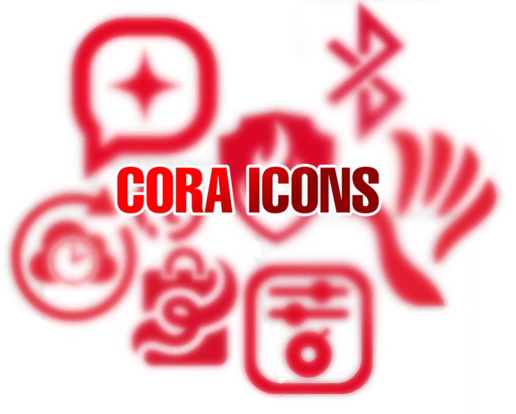

# CoraOS Icon Theme

A minimal, modern vector icon set designed for CoraOS, featuring clean geometry and vibrant red accents.

 *(replace preview.png with a screenshot of your icons)*

## Features
- **Minimal & Modern:** Clean lines with high legibility at any resolution.
- **Scalable SVG:** Native vector format ready for desktop Linux/Unix environments, web, or mobile apps.
- **Comprehensive Coverage:** Includes system settings, folder icons, file types, hardware, actions, and status indicators.

---

## Repository Structure

```text
coraos-icon-theme/
├── 16x16/       # Small UI & panel icons
├── 24x24/       # Toolbar & status icons
├── 48x48/       # Desktop & file manager icons
├── scalable/    # Vector SVG masters
└── README.md